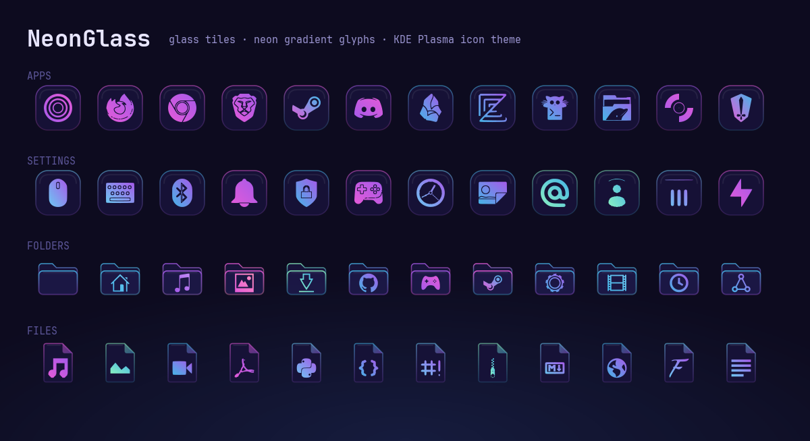

# NeonGlass icons

A KDE Plasma icon theme: dark glass tiles with neon gradient glyphs (cyan, violet, pink), made to match the [Neon Glass widgets](https://github.com/3L0935/neon-glass-widgets).



**What's in it**

- **Apps**: popular apps redrawn from their real logos, plus 17 common web browsers (Firefox, Chrome, Chromium, Brave, Vivaldi, Opera, Edge, LibreWolf, Tor Browser, Zen…).
- **System Settings**: every System Settings module icon on a glass tile.
- **Folders**: 16 folder types (home, music, games, GitHub, Steam…) in 7 colors: cyan, violet, pink, mint, lagoon, dusk, aurora.
- **File types**: every file type covered by Papirus, as a glass page with its symbol.
- **Tray**: the tray and panel icons in a cyan → violet gradient.

Everything else is inherited from **Papirus-Dark**, which must be installed.

## Install

You need Papirus: `papirus-icon-theme` on Arch, Fedora, Debian and Ubuntu.

**From a release**: extract `NeonGlass-<version>.tar.gz` into `~/.local/share/icons/`, then pick NeonGlass in System Settings → Colors & Themes → Icons.

**From source** (needs Python 3):

```sh
git clone https://github.com/3L0935/neon-glass-icons
cd neon-glass-icons
./install.sh lagoon --apply      # folder color: cyan | violet | pink | mint | lagoon | dusk | aurora
```

`install.sh` builds the theme, links it into `~/.local/share/icons/NeonGlass` and applies it. Run it again with another color to change the default folders. In Dolphin, you can also give one folder its own color: right click → Properties → click its icon → pick a `folder-<color>-<type>` icon.

## How it's made

The glyphs are vectorized from existing icons, then recolored and put on glass shapes:

| Script | Output |
|---|---|
| `tools/trace.py` | `glyphs.json`: app logos and folder symbols, traced from the icons installed on the maintainer's machine |
| `tools/trace_mime.py` | `mime.json`: the symbol of every Papirus file-type icon |
| `tools/trace_kcm.py` | `kcm.json`: System Settings module icons |
| `tools/trace_browsers.py` | `browsers.json`: browser logos |
| `tools/build.py` | the theme itself, from the `.json` files and the palette (`--folders <color>`, `--public`) |
| `tools/showcase.py` | `screenshots/showcase.png` |

The `.json` files are committed, so building only needs Python 3. The trace scripts need potrace, rsvg-convert, Pillow and the source icon themes.

## Extras

`extras/tray-mirror/` handles apps whose tray icon is a raw image, which no icon theme can restyle: Discord, Heroic and GPU Screen Recorder. For each of them, it shows a tray item of its own with NeonGlass icons. That item follows the app's state (Discord: unread, in a call, speaking, muted, deafened; GSR: idle, recording, paused) and relays the app's real menu and clicks.

```sh
mkdir -p ~/.local/share/neonglass ~/.config/systemd/user
cp extras/tray-mirror/neonglass-tray-mirror.py ~/.local/share/neonglass/
cp extras/tray-mirror/neonglass-tray-mirror.service ~/.config/systemd/user/
systemctl --user enable --now neonglass-tray-mirror.service
```

Then hide the apps' own entries in the tray settings (System Tray → Entries → set them to Hidden). Their ids, for the `hiddenItems` key of the tray config: `discord_status_icon_1`, `heroic_status_icon_1`, `gpu-screen-recorder-ui`.

## Credits and license

- **Papirus** icon theme (GPL-3.0) by the Papirus Development Team: file-type, System Settings and browser symbols are traced from it, and it's the fallback theme.
- **char-white** / Suru++ (GPL-3.0): monochrome app and folder symbols.
- App and browser logos are trademarks of their respective owners.
- Glass tiles, folders, pages, hand-drawn glyphs and scripts: 3L0_.

Because it's derived from GPL-3.0 artwork, NeonGlass is released under the **GPL-3.0** license ([LICENSE](LICENSE)).
